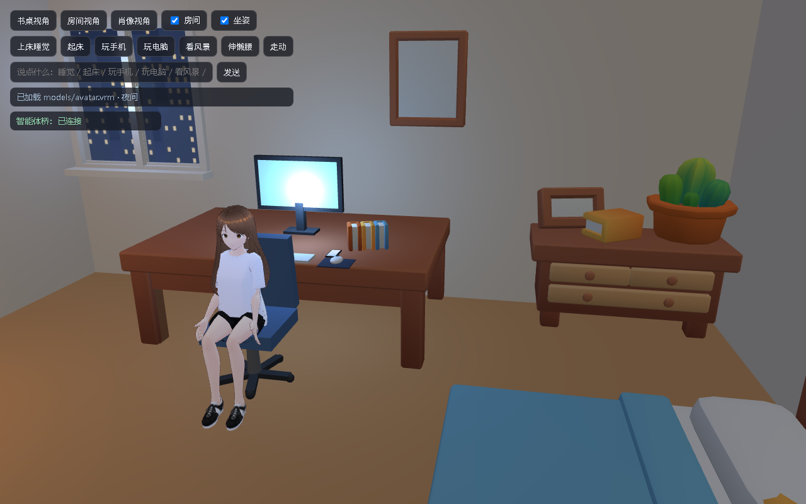

# AI World

一个可被**任意智能体**驱动的桌面 3D 房间：three.js 房间 + VRM 二次元角色，支持用文字、WebSocket 或 postMessage 让她睡觉、走动、玩手机、玩电脑、看风景，也支持「收到消息 → 拿手机看 → 回复 → 放下」这类消息驱动的行为。前身是 AI Room。



## 特性

- **3D 房间**：程序化墙面 / 窗户 / 窗外夜景，搭配 CC0 家具（床、书桌、椅子、柜子、台灯等），按本地时间自动切换昼夜。
- **VRM 角色**：待机呼吸与摆头、自动眨眼、TTS 音量驱动口型、情绪表情预设。
- **完整行为状态机**：坐 / 站 / 走 / 上床睡觉 / 起床 / 玩手机 / 玩电脑 / 看风景 / 伸懒腰，走路、上床、拿手机都有过渡动画，不会瞬移。
- **消息驱动**：智能体发一条消息 → 桌面手机弹出提示 → 她转身从桌上拿起手机 → 看消息 → 3 秒后回复并播报 → 放下手机；判断为「要她做事」的消息则直接去电脑前打字。
- **不绑定智能体**：文字指令、WebSocket、`postMessage` 三种入口，可接 Hermes 或任意 LLM Agent。
- **完全本地**：three.js 与 `@pixiv/three-vrm` 自托管在 `vendor/`，字体、贴图、模型全部本地，运行时 **0 外部请求**，可离线运行。
- **无构建步骤**：原生 ES Module + importmap，改完刷新即可。

## 快速开始

需要 Python（或任意静态文件服务器）与支持 WebGL2 的浏览器（Chrome / Edge）。

```bash
cd world
python -m http.server 8080
```

打开 <http://127.0.0.1:8080/>。

> 必须通过 HTTP 访问，直接双击 `index.html`（`file://`）会因为 ES Module 和模型加载的跨域限制而失败。

可选的语音桥（让智能体把 TTS 音频送进页面并驱动口型）：

```bash
pip install websockets
python -u tools/world_voice.py --demo
```

## 交互

页面左上角是 HUD，也可以直接在输入框里说一句话驱动她：

| 说法（示例） | 行为 |
| --- | --- |
| 睡觉 / 躺下 / 晚安 | 走到床边、坐下、收脚躺下 |
| 起床 / 醒来 | 下床站起 |
| 玩手机 | 从桌上拿起手机把玩 |
| 玩电脑 / 打字 | 转身面对显示器敲键盘 |
| 看风景 / 开窗 | 走到窗边抬头看外面 |
| 伸懒腰 | 站立伸懒腰 |
| 走动 / 散步 | 在房间里走一圈 |
| 坐下 / 站起 | 切换坐姿 / 站姿 |
| 书桌视角 / 房间视角 / 肖像视角 | 切换相机 |
| 桌宠 / 隐藏房间 | 关闭房间，只保留透明桌宠 |
| 其他任意文本 | 当成一条消息发给她（走消息流程） |

## 接入智能体

### WebSocket

页面默认连接 `ws://127.0.0.1:8777`，可用 `?bridge=ws://host:port` 覆盖。消息格式（JSON）：

```jsonc
{ "type": "speak", "url": "https://…/a.mp3", "text": "字幕" } // 或 data: base64 + mime
{ "type": "stop" }                                   // 打断当前语音
{ "type": "mouth", "value": 0.6 }                    // 手动口型 0~1
{ "type": "expression", "name": "happy" }            // happy | angry | sad | relaxed | surprised
{ "type": "state", "sitting": true, "roomVisible": true, "preset": "desk" }
{ "type": "action", "name": "sleep" }                // sleep | wake | phone | computer | window | stretch | walk | sit | stand
{ "type": "command", "text": "我想睡觉了" }           // 自然语言指令
{ "type": "message", "text": "帮我整理一下桌面", "mode": "auto", "reply": "好的" }
```

`mode` 可选 `auto`（默认，按内容判断）/ `chat`（拿手机看并回复）/ `task`（直接去电脑）。

### postMessage（Electron / Tauri / iframe）

```js
parent.postMessage({ __aiWorld: true, type: "message", text: "你好呀" }, "*");
```

### Python 语音桥

```python
from world_voice import WorldVoice

voice = WorldVoice()          # 默认 127.0.0.1:8777
await voice.start()
await voice.speak(wav_bytes, text="你好，我是你的智能体")
await voice.stop()
```

## 目录结构

```text
world/
├─ index.html               页面骨架、HUD、importmap
├─ main.js                  启动渲染器、HUD / 文字指令、字幕与消息转发
├─ world-layer.js           3D 房间、灯光、家具、角色姿态与行为状态机
├─ frontend/
│  ├─ vrm-renderer.js       VRM 渲染核心：渲染循环、口型、表情、眨眼
│  └─ world-bridge.js       智能体桥：WebSocket + postMessage
├─ tools/
│  └─ world_voice.py        Python 端语音桥（可选）
├─ vendor/                  three.js / @pixiv/three-vrm（MIT，自托管）
├─ assets/furniture/        KayKit Furniture Bits（CC0）
├─ models/avatar.vrm        VRM 示例形象
└─ docs/                    README 截图
```

## 自定义

- **换形象**：把任意 VRM 0.x / 1.0 模型放到 `models/avatar.vrm` 即可；渲染器会自动处理 VRM 0.x 的朝向。
- **改房间**：`world-layer.js` 顶部的 `PRESETS`、`CHAIR_POS`、`DESK_TOP`、`WINDOW_SPOT` 等常量控制相机与家具位置；家具为 glTF，可直接替换 `assets/furniture/` 下的文件。
- **接自己的智能体**：实现一个 WebSocket 服务端发送上表中的消息即可，页面不关心后端语言与框架。

## 许可证

本仓库代码以 **GNU General Public License v3.0（GPL-3.0）** 开源，完整条款见 [LICENSE](LICENSE)。

你可以自由使用、修改、分发本项目，也可以用于商业用途；但分发衍生作品时必须同样以 GPL-3.0 开源（copyleft），不能闭源分发。

第三方资源（各自遵循原许可证，均与 GPL-3.0 兼容）：

| 资源 | 许可证 | 说明 |
| --- | --- | --- |
| [three.js](https://threejs.org/) | MIT | `vendor/three.module.js` |
| [@pixiv/three-vrm](https://github.com/pixiv/three-vrm) | MIT | `vendor/three-vrm.module.js` |
| [KayKit Furniture Bits](https://kaylousberg.itch.io/kaykit-furniture-bits) | CC0 | 家具模型，作者 Kay Lousberg |
| `models/avatar.vrm` | VRM 1.0（pixiv `VRM1_Constraint_Twist_Sample`） | 允许再分发、修改与商业使用，署名非必需 |

如果你替换了 `models/avatar.vrm` 或家具资源，请自行确认新资源的许可。
